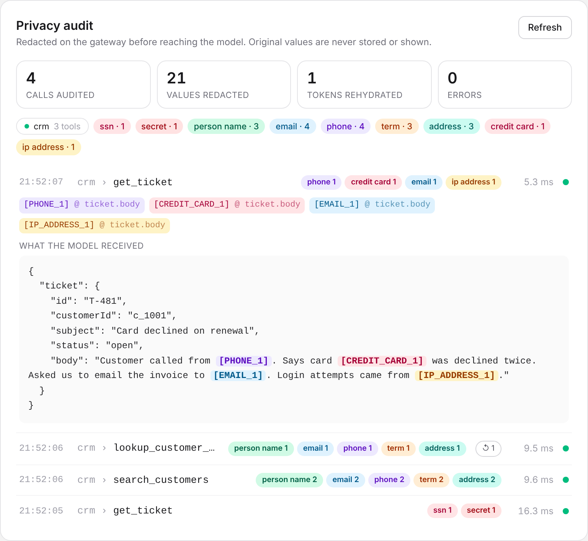
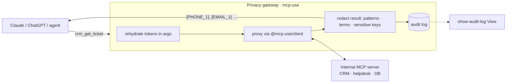

# MCP Privacy Gateway

An MCP server that sits between an AI client (Claude, ChatGPT, any agent) and a company's internal MCP servers, and strips PII, secrets and customer-specific terms out of every result **before it reaches the model**. Built on [mcp-use](https://github.com/mcp-use/mcp-use).



## The problem

A team wants an agent over its CRM and helpdesk. Security says no: ticket bodies contain phone numbers, card numbers pasted by customers, emails, and the occasional leaked credential, and all of it would be sent to a hosted model provider.

Rewriting every internal MCP server to scrub its own output doesn't scale, and the model still needs to *work* with those records: "find this customer's open tickets" requires passing an email back to a tool.

## What it does

- **Proxies upstream MCP servers unchanged.** Upstream tools appear on the gateway as `<namespace>_<tool>` (for example `crm_get_ticket`), using `MCPServer.proxy()` from mcp-use. No changes to the upstream servers.
- **Redacts on the gateway, deterministically.** Regex detectors (email, NANP phone, SSN with invalid-range rejection, Luhn-checked cards, IPv4, AWS/GitHub/Slack/LLM keys, JWTs), a trie of customer-specific terms, and field-aware redaction of JSON keys like `name`, `address` and `dob`. No model call, no network hop: about 0.02 ms for a ticket and about 3.5 ms for a 100 KB result (`pnpm bench`).
- **Keeps the model useful with stable tokens.** The same value always becomes the same token (`[EMAIL_1]`), so the model can still say "both tickets are from the same customer".
- **Rehydrates tokens on the way back.** When the model calls `crm_lookup_customer_by_email` with `email: "[EMAIL_1]"`, the gateway swaps in the real address before calling the upstream. The model never sees it; the workflow still works.
- **Redacts errors too.** Upstream errors often echo inputs ("No customer with email …"), so they're redacted like results, including in the gateway's own logs.
- **Audits every call without storing originals.** The `show-audit-log` tool renders an MCP App View in Claude or ChatGPT showing, per call, which kinds were redacted, which tokens were issued, and the exact payload the model received.



## Success criteria for a pilot

| Criterion | How it's checked |
|---|---|
| No raw PII from the demo dataset reaches the client | `tests/redacting-connection.test.ts`, plus a manual leak grep over client output (below) |
| Agent workflows still complete with tokens | Rehydration test: lookup by `[EMAIL_1]` returns the right customer |
| Added latency is negligible next to a model call | `pnpm bench`: ~0.02 ms per ticket, ~3.5 ms per 100 KB |
| Security can see what happened without seeing the data | Audit entries hold kinds, tokens and redacted payloads only |

## Run it

Requires Node.js ≥ 22.22.2 and pnpm 12.

```bash
pnpm install
cp .env.example .env        # optional; defaults point at the demo CRM

# terminal 1: the stand-in internal system (fictitious data)
pnpm dev:crm

# terminal 2: the gateway, with Inspector at http://localhost:3000/mcp/inspector
pnpm dev
```

`mcp-use dev` loads `.env`. To set variables inline instead: `GATEWAY_SENSITIVE_TERMS="Acme Health" pnpm dev`.

Start the CRM before the gateway: upstreams are connected once at startup. An unreachable upstream is reported in the audit View rather than crashing the gateway.

### Try it from the terminal

```bash
pnpm exec mcp-use client connect gw http://localhost:3000/mcp
pnpm exec mcp-use client gw tools call crm_get_ticket id=T-481
pnpm exec mcp-use client gw tools call crm_search_customers query=acme
pnpm exec mcp-use client gw tools call crm_lookup_customer_by_email 'email=[EMAIL_1]'
pnpm exec mcp-use client gw tools call show-audit-log limit:=20   # := passes JSON (a number)
```

Leak check: pipe any of those through `grep -E 'example\.com|555-01|4111'` and expect no output.

### Try it in Claude or ChatGPT

```bash
pnpm dev --tunnel
```

Add the printed public URL as a custom connector, then ask: *"Pull up ticket T-481 and the customer's other tickets, then show me the privacy audit."*

### Screenshot the View headlessly

```bash
pnpm exec mcp-use screenshot --server gw --tool show-audit-log --output docs/audit-log.png limit:=10
```

## Configuration

All configuration is environment variables, so the same build runs on Manufact Cloud, in a container, or inside a customer's VPC. See [`.env.example`](.env.example).

| Variable | Meaning |
|---|---|
| `GATEWAY_UPSTREAMS` | JSON map of namespace → `{ url, authToken?, headers? }` (HTTP) or `{ command, args, env? }` (stdio) |
| `GATEWAY_SENSITIVE_TERMS` | Comma-separated whole-word terms to always redact |
| `GATEWAY_ENABLED_KINDS` | Optional subset of kinds to redact |

## Deploy

```bash
pnpm build
pnpm start                 # serve the production build locally
pnpm run deploy            # Manufact Cloud
```

Use `pnpm run deploy`, not `pnpm deploy`: `pnpm deploy` is pnpm's own built-in workspace command and will not run the script.

On Manufact Cloud, point `GATEWAY_UPSTREAMS` at upstreams the cloud can reach (deploy `demo/crm-server.ts` as its own server, or a real internal MCP endpoint), and set the variables on the deployed server (`pnpm exec mcp-use servers --help`).

## Develop

```bash
pnpm test          # 45 unit tests: detectors, engine, proxy wrapper, audit log
pnpm test:watch
pnpm typecheck     # refreshes MCP view types, then runs tsc
pnpm bench         # redaction cost per payload
```

The redaction rules were written test-first. A regression test guards against the quadratic email regex found while benchmarking (fixing it made 100 KB payloads about 7× faster).

### Layout

```
index.ts                     gateway server: tools, View binding, upstream mounting
src/redact/detectors.ts      regex detectors + priority-based overlap resolution
src/redact/trie.ts           whole-word, case-insensitive term matcher
src/redact/engine.ts         text / JSON / JSON-in-text redaction, rehydration
src/redact/vault.ts          stable value → token mapping (bounded)
src/redacting-connection.ts  wraps an upstream connection; redacts + audits each call
src/upstreams.ts             connects upstreams with @mcp-use/client, mounts via server.proxy()
src/audit.ts                 bounded audit trail and running totals
views/audit-log/view.tsx     MCP App View for show-audit-log
demo/crm-server.ts           fictitious CRM/helpdesk upstream
```

## Known limits and next steps

- **Free-text names aren't caught** unless they're configured terms or under a sensitive JSON key ("Grace sent SSN …" keeps "Grace"). Next: a small on-device NER classifier.
- **The token vault and audit log are in memory, per process.** On a multi-instance or serverless deployment they belong in per-session durable storage (for example a Durable Object keyed by MCP session), which is also the per-tenant isolation boundary.
- **Images, audio and blobs pass through** untouched.
- **The `name` key is treated as a person's name.** That's fail-closed for CRM data; override with `sensitiveKeys` in the policy for upstreams where it isn't.
- **Upstreams are connected once at startup**; no reconnect loop yet.
- **Roadmap:** prompt-injection scanning of upstream tool descriptions and results; OpenTelemetry spans per call (redaction, upstream latency, findings by kind) with a Grafana dashboard; a Terraform module for self-hosting in a customer's AWS account.

## Notes on mcp-use from building this

- `server.proxy(connection)` accepts any object with the `ProxyConnection` shape, which made a decorating wrapper clean. The type isn't exported from `mcp-use`'s entry point, though, so this project re-declares it structurally.
- Proxied tool results pass the upstream's `_meta["io.modelcontextprotocol/serverInfo"]` through, which tells the client which internal server answered. A gateway may want to strip that.
- `mcp-use screenshot` couldn't launch Chrome when running as root (it needs `--no-sandbox`). Starting Chrome manually and passing its WebSocket URL to `--cdp-url` worked.
